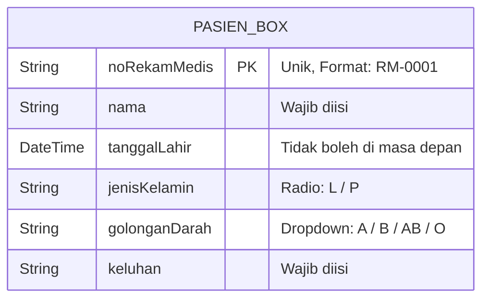
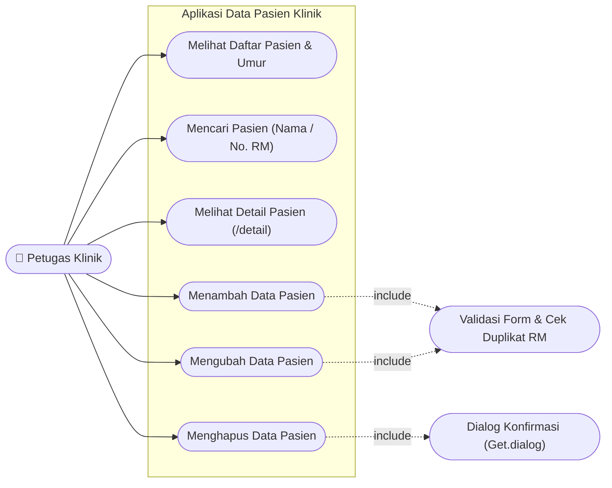
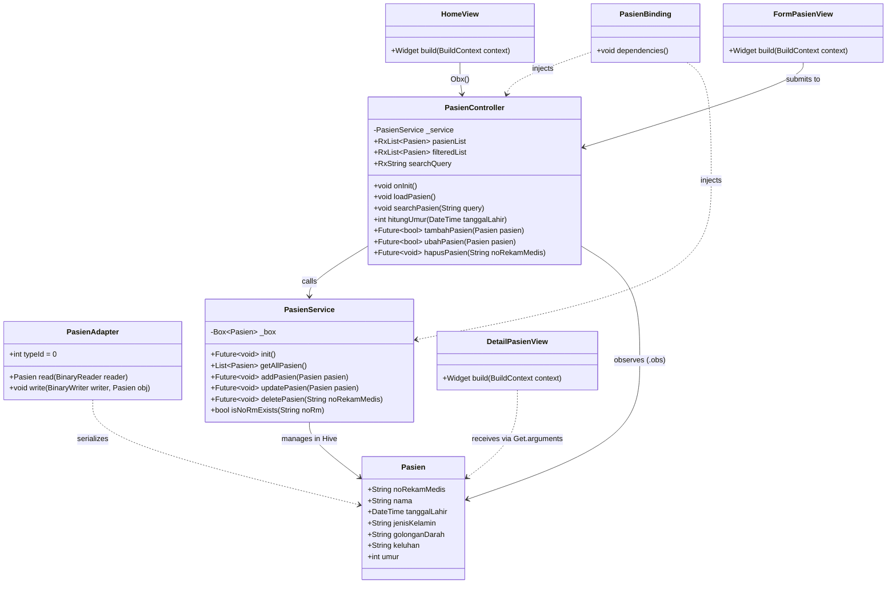
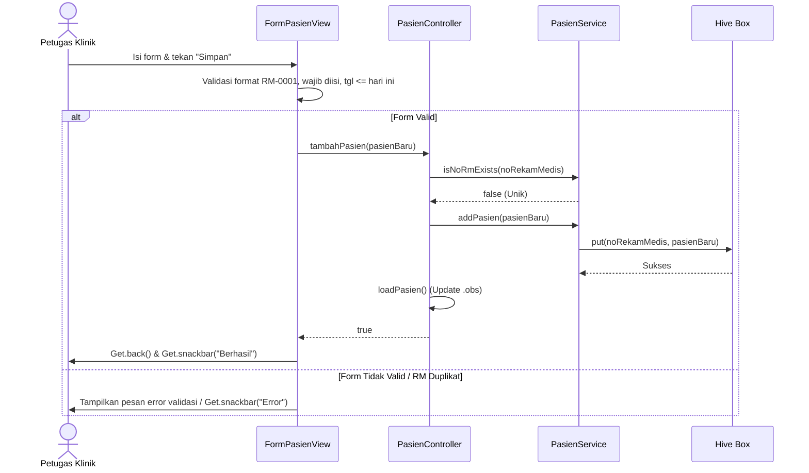
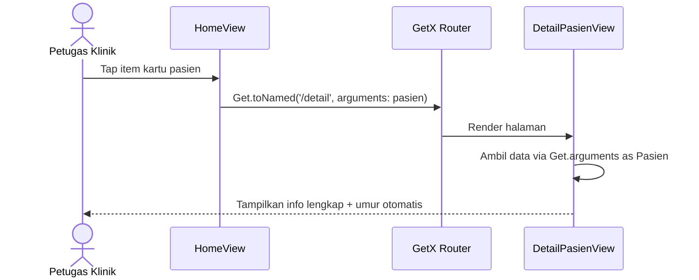

# Rancangan Sistem: Aplikasi Data Pasien Klinik (Paket 5)

Dokumen ini berisi perancangan arsitektur, basis data lokal (Hive), dan pemodelan UML untuk aplikasi mobile Flutter CRUD **Data Pasien Klinik** dengan arsitektur **MVC + GetX**.

---

## 1. Entity Relationship Diagram (ERD) / Skema Penyimpanan Lokal (Hive)

Karena aplikasi menggunakan **Hive** (NoSQL berbasis key-value / Box) dengan 1 model utama (`Pasien`), berikut adalah representasi struktur entitas/objek penyimpanannya:



### Detail Skema Model & Hive TypeAdapter:
* **Nama Box:** `pasienBox`
* **TypeId:** `0` (Unik)
* **Urutan Field pada `TypeAdapter` (Wajib konsisten antara `read` dan `write`):**
  * `0`: `noRekamMedis` (`String`) — *Dijadikan Key pada Box untuk memastikan keunikan*
  * `1`: `nama` (`String`)
  * `2`: `tanggalLahir` (`DateTime`)
  * `3`: `jenisKelamin` (`String`)
  * `4`: `golonganDarah` (`String`)
  * `5`: `keluhan` (`String`)

---

## 2. UML: Use Case Diagram

Diagram ini menggambarkan interaksi antara **Petugas Klinik (User)** dengan fitur-fitur utama yang wajib ada pada Paket 5.



---

## 3. UML: Class Diagram (Arsitektur MVC + GetX)

Diagram ini memetakan relasi antar lapisan (`models`, `services`, `controllers`, `bindings`, `views`, dan `routes`) sesuai aturan bahwa **View tidak boleh mengakses Hive secara langsung**.



---

## 4. UML: Sequence Diagram (Alur Tambah Data & Detail)

### A. Alur Tambah Pasien (Create + Validasi)


### B. Alur Navigasi ke Halaman Detail (`/detail`)


---

## 5. Struktur Folder Proyek (MVC)

Susunan direktori di dalam folder `lib/` dan `test/` agar memenuhi kriteria penilaian:

```text
lib/
├── main.dart                     # Inisialisasi Hive, Register Adapter, GetMaterialApp
├── models/
│   ├── pasien.dart               # Class model Pasien + getter hitung umur
│   └── pasien_adapter.dart       # Manual / Generated Hive TypeAdapter (typeId: 0)
├── services/
│   └── pasien_service.dart       # Logika CRUD langsung ke Hive Box
├── controllers/
│   └── pasien_controller.dart    # State management (.obs), pencarian, & validasi bisnis
├── bindings/
│   └── pasien_binding.dart       # Dependency Injection (Get.lazyPut)
├── routes/
│   ├── app_pages.dart            # Daftar GetPage (/, /form, /detail)
│   └── app_routes.dart           # Konstanta nama route
└── views/
    ├── home_view.dart            # Daftar pasien (Obx), search bar, empty state, & hapus
    ├── form_pasien_view.dart     # Form tambah & edit pasien (DatePicker, Radio, Dropdown)
    └── detail_pasien_view.dart   # Halaman detail pasien menerima Get.arguments

test/
└── pasien_service_test.dart      # Minimal 3 unit test (Create/Read, Update, Delete)
```

---

## 6. Checklist Aturan Validasi & Fitur Khusus Paket 5

1. **Validasi Field:**
   * `noRekamMedis`: Regex `^RM-\d{4}$` (contoh: `RM-0001`) + cek keunikan di `PasienService` saat tambah data.
   * `nama` & `keluhan`: Tidak boleh kosong (`value == null || value.trim().isEmpty`).
   * `tanggalLahir`: Menggunakan `showDatePicker` dengan batas maksimal `lastDate: DateTime.now()`.
   * `jenisKelamin`: Menggunakan widget `Radio` / `RadioListTile` dengan opsi `'L'` dan `'P'`.
   * `golonganDarah`: Menggunakan `DropdownButtonFormField` dengan opsi `['A', 'B', 'AB', 'O']`.
2. **Perhitungan Umur Otomatis:**
   * Dihitung dari selisih tahun `DateTime.now()` dengan `tanggalLahir` (memperhatikan bulan dan hari ulang tahun di tahun berjalan) dan ditampilkan langsung pada kartu pasien di halaman daftar.
3. **Routing & Arguments:**
   * Halaman daftar: `'/'` (atau `'/home'`)
   * Halaman form (Tambah/Edit): `'/form'`
   * Halaman detail: `'/detail'` menggunakan `Get.toNamed('/detail', arguments: pasien)`
4. **Unit Testing (`flutter test`):**
   * Gunakan `Hive.init('./test_hive')` (atau `Directory.systemTemp.createTempSync()`) pada blok `setUp()` di file `pasien_service_test.dart` agar unit test bisa berjalan tanpa emulator/HP.